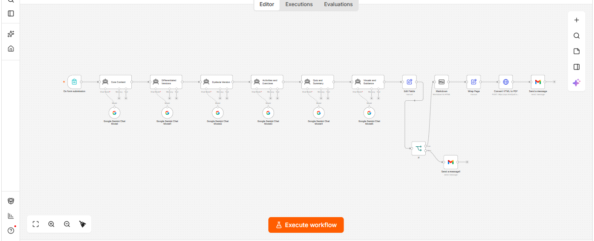

# Teachwise: AI Teaching Materials Generator

> Enter a lesson topic once. Get a complete, differentiated, dyslexia-friendly teaching package as a PDF in your inbox.

Teachwise is an [n8n](https://n8n.io) workflow that uses Google Gemini agents to turn a short teacher form into a full resource package for primary-school lessons. The package is checked for completeness, converted to PDF, and emailed to the teacher.



##  Demo

[▶ Watch the demo video](demo/teachwise-demo.mp4)

---

##  Features

- **One form, full package**: 11 inputs produce 12 structured sections (A to L).
- **Differentiated learning**: Beginner, Intermediate and Advanced versions of the same lesson.
- **Dyslexia-friendly version**: word banks, short steps, sentence starters and a list of the adaptations used.
- **Ready to teach**: activities, practice exercises, discussion questions, quiz with answer key, and summary.
- **Visual prompts**: ready-to-use prompts for diagrams, organizers and infographics.
- **Teacher guidance**: scaffolding, extension options, and what to verify before use.
- **Quality gate**: an `If` node checks that all 12 sections exist before sending. If any is missing, the teacher gets a "run again" email instead of a broken file.
- **Multi-language**: output follows the language chosen in the form.

---

##  How It Works

```
Form → 6 Gemini agents (in sequence) → Merge → Completeness check
        → Markdown → HTML → PDF → Gmail
```

| # | Node | Produces |
|---|------|----------|
| 1 | **On form submission** | Collects the teacher inputs |
| 2 | **Core Content** | A. Learning objectives and success criteria · B. Teacher explanation · C. Student handout |
| 3 | **Differentiated Versions** | D. Beginner / Intermediate / Advanced versions |
| 4 | **Dyslexia Version** | E. Dyslexia-friendly learning version |
| 5 | **Activities and Exercises** | F. Examples and activities · G. Practice exercises · H. Discussion questions |
| 6 | **Quiz and Summary** | I. Quiz and answer key · J. Summary |
| 7 | **Visuals and Guidance** | K. Visual-content prompts · L. Accessibility and teacher guidance |
| 8 | **Edit Fields** | Merges everything into one Markdown package |
| 9 | **If** | Verifies sections A to L are all present |
| 10 | **Markdown → Wrap Page → Convert HTML to PDF** | Builds the styled PDF |
| 11 | **Send a message** (Gmail) | Emails the PDF to the teacher |
| ✗ | **Send a message1** (Gmail) | Failure path: "package incomplete, please run again" |

All agents use `gemini-3.1-flash-lite` and share the same system prompt: an inclusive-education specialist who follows differentiated instruction and UDL, never invents curriculum standards, and keeps teacher-facing and student-facing content separate.

---

##  Form Fields


| Field | Required | Description |
|-------|:--------:|-------------|
| Subject | ✅ | e.g. Science |
| Grade Level | ✅ | e.g. Grade 3 |
| Lesson Topic | ✅ | e.g. Magnets |
| Learning Objective | ✅ | What students should know or be able to do |
| Lesson Duration | ✅ | e.g. 45 minutes |
| Language | ✅ | Output language |
| Email | ✅ | Where the PDF is sent |
| Curriculum or Standards | | Optional. The model will not claim alignment that was not verified |
| Available Resources | | Optional. Used for the hands-on activity |
| Specific Learner Needs | | Optional |
| Assessment Requirements | | Optional. Shapes the quiz |
 
---

## Tech Stack

- [n8n](https://n8n.io) (workflow automation)
- Google Gemini via the n8n Chat Model node
- [html2pdf.app](https://html2pdf.app) API (HTML to PDF)
- Gmail (OAuth2)

---

##  Setup

### 1. Import the workflow
In n8n: **Workflows → Import from File** and select
[`workflows/teaching-materials-generator.json`](workflows/teaching-materials-generator.json).

### 2. Add credentials
| Credential | Used by |
|-----------|---------|
| Google Gemini (PaLM) API key | The 6 `Google Gemini Chat Model` nodes |
| Gmail OAuth2 | `Send a message` and `Send a message1` |

### 3. Configure the PDF service
Open the **Convert HTML to PDF** node and replace `YOUR_HTML2PDF_API_KEY` in the URL with your own html2pdf.app key.

> 🔐 Never commit a real key. Better still, store it as an n8n credential or environment variable.

### 4. Check the Gmail attachment
In the **Send a message** node, make sure the attachment field points to the PDF binary property returned by the PDF node (usually `data`).

### 5. Activate and use
Activate the workflow, open the form URL from the **On form submission** node, fill it in, and check your inbox.

---

##  Repository Structure

```
teachwise/
├── README.md
├── .gitignore
├── workflows/
│   └── teaching-materials-generator.json
├── docs/
│   ├── technical-workflow-specification.pdf
│   ├── prompt-library.pdf
│   ├── sample-output-teaching-material-package.pdf
│   └── images/
│       └── workflow.png
└── demo/
    └── teachwise-demo.mp4
```

##  Documentation

- [Technical Workflow Specification](docs/technical-workflow-specification.pdf)
- [Prompt Library](docs/prompt-library.pdf)
- [Sample Output](docs/sample-output-teaching-material-package.pdf)

---

## ⚠️ Limitations

- Content is AI-generated. **Teachers should review it** for accuracy and grade-fit before classroom use.
- Curriculum alignment is not verified by the workflow.
- Agents run sequentially, so generation can take a few minutes.
- The dyslexia strategies are adaptable options, not a fixed prescription for every student.

##  Roadmap

- [ ] Image generation from the visual-content prompts
- [ ] Save packages to Google Drive
- [ ] Retry only the missing section instead of failing the whole run
- [ ] Support more subjects beyond primary science

##  Contributing

Issues and pull requests are welcome. When editing the workflow, export it again and remove any keys or personal emails before committing.

##  License

MIT